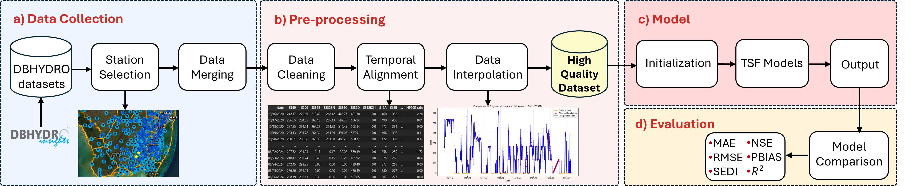
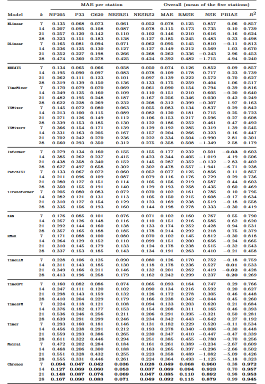

# Everglades-Benchmark
In this study, we investigate twelve task-specific models and five time series foundation models across six categories for a real-world application focused on water level prediction in the Everglades.

Here's an overview of our framework for water level forecasting.


## Installation

1. Create & activate your Python environment:
    - `conda create -n ENV_NAME python=3.10`
    - `conda activate ENV_NAME`

2. Install dependencies:
    - `pip install -r requirements.txt`

3. Verify your setup:
    - `python --version`  # should show Python 3.10.x
    - `pip list`          # confirm key packages are installed

## Directory Tree
```text

Everglades-Benchmark/                         - repository root
├── README.md
├── requirements.txt                          - pinned Python dependencies
├── requirements_chronos.txt                  - pinned dependencies for a separate Chronos-Bolt environment
├── data/
│   ├── final_concatenated_data.csv           - raw & processed time-series data
│   ├── results_all_horizons.csv              - per-station MAE and RMSE and overall metrics of all models at all lead times
│   └── Results-28days-final.xlsx             - results of all models
├── task-specific-models/                     - task-specific forecasting models
│   ├── Everglades-TaskSpecific-Models28days.ipynb   - NBEATS, NLinear, DLinear, TimeMixer, TSMixer, TSMixerx,
│   │                                                  PatchTST, iTransformer, KAN, RMoK
│   └── Everglades-Informer-28days.ipynb
├── foundation-models/                        - time series foundation models (zero-shot)
│   ├── Everglades-Chronos-28days.ipynb
│   ├── Everglades-Moirai-28days.ipynb
│   ├── Everglades-TimeGPT-28days.ipynb
│   ├── Everglades-Timer-28days.ipynb
│   ├── Everglades-TimesFM-28days.ipynb
│   └── Everglades-TimeLLM-28days.ipynb       
├── extreme-case-evaluation/                  - extreme-event evaluation
│   ├── Everglades-SEDI-Metrics.ipynb         - threshold-based SEDI (T-SEDI) for all models
│   ├── G620_visualization.jpeg               - forecast plots against the extreme-value thresholds, helping understand TSMixerx behavior
│   ├── NESRS1_visual.jpeg
│   └── P33_visual.jpeg
├── Missingness Statistics/                   - missing-data statistics and interpolation examples
│   ├── MissingData-All-Variables.png
│   ├── Percentage_Missing_Values.png
│   └── Interpolation.png
├── Visualizations/                           - analysis and plotting notebooks
│   ├── Everglades-Station-Variables-Analysis.ipynb
│   ├── Everglades-ParameterStudy-Viz.ipynb
│   ├── Everglades-Data-Visualizations-ActualvsPred.ipynb
│   └── Everglades-Inference-Time-Visualization.ipynb
├── figure/                                   - figures used in this README and the analysis
│   ├── Framework_visual.png                  - benchmark overview
│   ├── Benchmark-Table-results.png           - results of all models
│   ├── CorrelationNew.jpeg                   - correlation of the station variables
│   ├── Model-Complexity.png                  - accuracy, inference time and model size
│   ├── ChronosParameterStudy.png             - Chronos parameter study
│   └── TSFM-Parameter-Study.png              - foundation model parameter study
└── Web-Demo-Application/                     - interactive benchmark website
    ├── everglades-benchmark-web/             - website source (see its own README)
    │   ├── README.md                         - setup, running and testing the website
    │   ├── core/everglades_core/             - shared configuration, data split, metrics and results store
    │   ├── workers/
    │   │   ├── nf_worker/                    - service for the 11 NeuralForecast models
    │   │   └── chronos_worker/               - service for Chronos-Bolt
    │   ├── web/                              - Streamlit website
    │   ├── scripts/                          - running models without the website, parity checks, export
    │   ├── tests/                            - automated tests and published prediction fixtures
    │   └── data/final_concatenated_data.csv  - copy of the benchmark dataset
    └── Web-Visuals-Screenshots/              - screenshots of the website pages
```
## Usage

Launch Jupyter and run the notebooks:

- Task-specific models
    - Trains and evaluates Informer and other classical architectures. Run the ipynb files under the task-specific-models folder to reproduce the experiment results.

- Foundation models
    - Run the ipynb files under the foundation-models folder to reproduce the experiment results.

- Extreme-case evaluation
    - Run the ipynb file under the extreme-case-evaluation folder to compute the Symmetric Extremal Dependence Index for each method.

- Visualizations
    - Station-variable correlations: Visualizations/Everglades-Station-Variables-Analysis.ipynb
    - Parameter study plots: Visualizations/Everglades-ParameterStudy-Viz.ipynb
    - Actual vs. predicted time-series: Visualizations/Everglades-Data-Visualizations-ActualvsPred.ipynb
    - Inference time comparison: Visualizations/Everglades-Inference-Time-Visualization.ipynb

## Web Demo Usage

The `Web_Demo_Application/` folder contains two interactive Streamlit applications:

- **app_chronos_autogluon.py** → Chronos-Bolt forecasting demo  
- **app_neuralforecast_everglades.py** → Task-specific models benchmark demo  

To run either applications:

1. **Navigate into the project folder**  
   `cd Everglades-Benchmark/Web_Demo_Application`

2. **Install the required environment**
        
For the Task-specific models demo:
  - `pip install -r ../requirements.txt`

For the Chronos-Bolt demo (requires separate env):
  - `pip install -r requirements_chronos.txt`

3. **Launch Streamlit**

- `streamlit run app_chronos_autogluon.py`  
or
- `streamlit run app_neuralforecast_everglades.py`

## Results
The table below shows how each model performs across 5 stations (NP205, P33, G620, NESRS1, NESRS2) for lead times of 7, 14, 21, and 28 days. The first 12 models are task-specific, while the last 5 are pre-trained foundation models for time series. The best results are in bold.

<p align="center">
  
</p>
